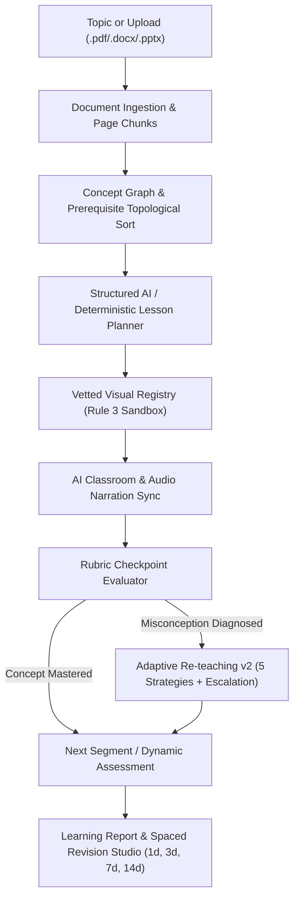

# Edukriti

Edukriti is a multilingual, adaptive AI teacher that converts any topic or uploaded study material into a grounded, avatar-led interactive lesson. It explains concepts prerequisite-first, embeds vetted STEM simulations and 3D scenes, checks understanding with rubric-based checkpoints, diagnoses misconceptions, adapts its teaching approach with five pedagogical strategies, conducts dynamic assessments targeting weak concepts, and schedules cognitive spaced revision.

## Working prototype

The public demo is available at [vercel-sigma-eight-16.vercel.app](https://vercel-sigma-eight-16.vercel.app). Its Cloudflare-compatible application origin is [edukriti-ai-teacher.fuzailahmad2006.chatgpt.site](https://edukriti-ai-teacher.fuzailahmad2006.chatgpt.site).

Canonical journey:

> Upload (.pdf, .txt, .docx, .pptx) or topic → personalization & variant mode → concept graph lesson plan → AI classroom & vetted STEM visual → rubric checkpoint → adaptive re-teaching v2 → dynamic assessment → learning report & spaced revision

## Key capabilities

- **Multi-Format Document Ingestion**: Native PDF, TXT, Word (.docx via Mammoth), and PowerPoint (.pptx via slide XML) parsing with page- and slide-level citations.
- **Concept Knowledge Graph**: Directed acyclic graph of 16 curated STEM concepts with prerequisite topological sorting (foundations always precede dependent topics).
- **Vetted Interactive Visual Registry**: 10 sandboxed STEM simulations, virtual labs, 3D scenes, and diagrams (Rule 3: AI selects vetted IDs and validated parameters; never writes executable code).
- **Interactive Visual Viewer**: Real-time parameter controls, physical preset configurations, reset buttons, and audio narration cue timeline synchronization.
- **Rubric-Based Checkpoint Grading**: Replaces regex matching with structured key ideas, common misconception diagnostics, and proximity-aware conceptual scoring.
- **Adaptive Re-teaching v2**: Five pedagogical strategies (`new_analogy`, `worked_example`, `simpler_prerequisite`, `visual_walkthrough`, `interactive`) with 3-stage prerequisite escalation.
- **Dynamic Weak-Concept Assessments**: Subject-tailored multi-question assessments generated from the concept graph, prioritizing the learner's recorded weak concepts.
- **Lesson Variants & Scaling**: 5-minute flash review, 20-minute standard lesson, and 60-minute deep-dive options across `standard`, `exam_focused`, and `practical` modes.
- **Cognitive Spaced Revision Studio**: Scheduled retention reviews (1, 3, 7, and 14 days) linked directly to concept mastery.
- **Multilingual Spoken Narration**: Natural speaking phrasing, analogies, and pacing in English, Hindi, and Hinglish with regional neural voice preferences.
- **Omnipresent "Ask Aarohi" AI Study Companion**: Global drawer (`Ctrl+/`), full `/tutor` station, SSE streaming, multimodal photo doubts, and hands-free voice loop.
- **Parametric Practice Engine**: 60 seeded Mulberry32 PRNG template families generating 82,075+ unique numerical problems with authentic mistake distractors.
- **Rasch / Elo Adaptive Selector**: Zone of Proximal Development ($P \in [0.55, 0.75]$) item matching and cognitive spaced repetition scheduling.
- **Sectional Mock Test Arena**: Full-length timed exams with sectional analysis and authentic empirical percentile scoring.
- **Dual-Solve Verification & Open Benchmarks**: Automatic independent second solve and semantic deduplication over open benchmarks (GSM8K, MATH, ARC, OpenBookQA).
- **Deterministic Numerical Solver**: Safe arithmetic and SI unit normalization verifying mathematical formulas with zero unvetted code execution.
- **100% Offline Uptime**: High-quality deterministic fallback ensures all lessons, simulations, rubrics, and assessments run offline with zero API keys.

## Verified System Metrics (Honest Numbers — Rule 4)

All metrics below are computed directly from the source code and immutable registries:

| Metric | Verified Count | Source |
| :--- | :--- | :--- |
| **Vetted Interactive Visuals** | **10** (3 sims, 3 labs, 3 3D scenes, 1 diagram) | `packages/contracts/src/vetted-visuals.ts` |
| **Knowledge Graph Concepts** | **16** nodes across 5 STEM disciplines | `packages/teaching-engine/src/concept-graph.ts` |
| **Document Formats Supported** | **4** (.pdf, .txt, .docx, .pptx) | `packages/rag/src/index.ts` |
| **Adaptive Reteaching Strategies** | **5** (`new_analogy`, `worked_example`, `simpler_prerequisite`, `visual_walkthrough`, `interactive`) | `packages/teaching-engine/src/index.ts` |
| **Parametric Question Families** | **60** seeded PRNG template families | `packages/questions/src/registry.ts` |
| **Estimated Unique Problems** | **82,075+** computed combinations from parameter ranges | `packages/questions/src/registry.ts` |
| **Imported Benchmark Items** | **16** verified items (GSM8K, MATH, ARC, OpenBookQA) | `packages/questions/src/datasets/dataset-registry.ts` |
| **Ask Aarohi Benchmark Questions** | **105** multi-subject evaluated questions | `packages/teaching-engine/src/golden-eval-set.ts` |
| **Automated Monorepo Tests** | **125 Passing Tests** (0 failing) | `npm test` across all 5 workspaces |

## Architecture



The application uses a Node.js 24 npm-workspace monorepo, strict TypeScript, Vinext/React, Cloudflare Workers, D1 for structured learning history, and R2 for uploaded materials. Zod validates every public contract and module boundary.

## AI, RAG, and teaching approach

- `packages/ai`: Resilient dual-tier provider adapter supporting Google Gemini 2.5 Flash (default via `GEMINI_API_KEY`), OpenAI (via `OPENAI_API_KEY`), and an offline deterministic fallback with in-memory caching and automatic single-retry on schema errors.
- `packages/rag`: Normalizes untrusted document text (.pdf, .txt, .docx, .pptx), creates bounded overlapping page chunks, and ranks evidence with page-level citations.
- `packages/teaching-engine`: Generates prerequisite-first lesson plans, spoken narration, rubrics, adaptive re-teaching v2, weak-concept assessments, and numerical solutions across any topic.
- `packages/contracts`: Strict Zod runtime schemas, vetted visual registry, honest metrics calculations, and API contracts.
- A deterministic teaching provider keeps the complete demo functional without paid APIs, ensuring 100% offline uptime for hackathon judging.
- System health and real-time latency can be inspected at the `/admin/status` diagnostic dashboard.

## Local setup

Requirements: Node.js 24 and npm.

```bash
npm install
npm test
npm run dev
```

Run typecheck and build:

```bash
npm run typecheck
npm run build
```

Run Ask Aarohi benchmark evaluation:

```bash
npm run eval
```

## Main APIs

| Endpoint | Purpose |
| --- | --- |
| `GET /api/health` | Service health status |
| `GET /api/health/ai` | Live AI provider roundtrip ping and feature diagnosis |
| `POST /api/sources` | Validate, store, and extract uploaded material (.pdf, .txt, .docx, .pptx) |
| `POST /api/retrieval` | Retrieve grounded source passages with citations |
| `POST /api/lessons` | Generate and persist a personalized lesson with vetted visuals |
| `GET /api/lessons/:id` | Retrieve a validated lesson plan |
| `POST /api/checkpoints` | Evaluate with rubrics and trigger adaptive re-teaching v2 |
| `GET/POST /api/assessments` | Generate weak-concept targeted assessment and grade answers |
| `POST /api/tutor` | Ask Aarohi multimodal question answering with grounding |
| `POST /api/tutor/stream` | Server-Sent Events (SSE) progressive streaming for Ask Aarohi |
| `POST /api/tutor/feedback` | Record student pedagogical rating and quality signals |
| `POST /api/reports` | Generate a report from recorded answers |
| `GET /api/reports/:id` | Retrieve a completed learning report |
| `GET /api/questions` | Paginated question bank queries with subject and difficulty filters |
| `POST /api/questions/submit` | Evaluate student practice submission and diagnose error misconceptions |
| `POST /api/questions/adaptive` | Rasch 1PL item selection within Zone of Proximal Development |
| `POST /api/questions/bookmark` | Toggle question bookmark in session repository |
| `POST /api/questions/report` | Submit question quality report flag |
| `POST /api/mock-tests` | Generate full-length sectional timed mock test |
| `POST /api/mock-tests/submit` | Grade mock test with empirical cohort percentile scoring |
| `GET /api/admin/practice-stats` | Real-time computed question bank and parametric diagnostics |

## Licensing & Attribution

All educational datasets, benchmarks, simulations, and 3D scenes use open licenses (OpenStax CC BY 4.0, Wikipedia CC BY-SA 4.0, PubChem CC0, GSM8K/MATH MIT). Full source documentation and licensing details are cataloged in [`docs/DATA_SOURCES.md`](docs/DATA_SOURCES.md).
